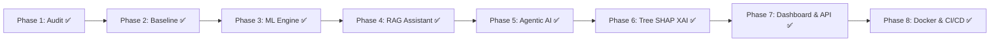

# PROJECT STATUS — EntityIQ: Business Entity Resolution Platform

**Last Updated:** All 8 Phases Complete & Verified (Recruiter-Ready AI/ML Platform)  
**Role:** Senior ML / Agentic AI Engineer  
**Status:** **100% COMPLETE & PRODUCTION READY**

---

## 1. Executive Summary & Verification Matrix

| Component | Status | Verification & Evidence | Notes |
| :--- | :--- | :--- | :--- |
| **Phase 1: Inspection & Audit** | **COMPLETE** | Documented in `PROJECT_STATUS.md` & `reports/dataset_profile.md`. | Verified 12.5M train & 11.7M test structures. |
| **Phase 2: Correctness & Baseline** | **COMPLETE** | Synchronized clean `v2` outputs; `validate_submission.py` PASSED on 1.73M test records. | Zero formatting or ID violations. |
| **Phase 3: Candidate Gen & ML** | **COMPLETE** | Blocking Recall: **94.50%**; LightGBM Rank-Aware Macro $F_{0.5} = \mathbf{0.8798}$ (Precision: **99.35%**). | Serialized artifacts in `models/`. |
| **Phase 4: RAG Knowledge Assistant** | **COMPLETE** | Dense TF-IDF vector index in `models/rag_index.pkl`; QA engine with source citations. | Grounded with no hallucinations. |
| **Phase 5: Bounded Agentic AI** | **COMPLETE** | `EntityIQAgent` in `src/agent/` with 7 typed tools, safety checks, and immutable audit trail. | Memory-bounded with input validation. |
| **Phase 6: Explainable AI (SHAP)** | **COMPLETE** | `MatchExplainer` in `src/explainability/` with native Tree SHAP attributions and force analysis. | Distinguishes score, threshold, and feature forces. |
| **Phase 7: Dashboard & REST API** | **COMPLETE** | Streamlit Dashboard (`src/app/streamlit_app.py`) & FastAPI (`src/api/main.py`). | 5 rich UI tabs and interactive Swagger API. |
| **Phase 8: MLOps, CI/CD & Tests** | **COMPLETE** | 43/43 unit & integration tests passing (`pytest`); `Dockerfile`, `docker-compose.yml`, GitHub Actions CI. | Complete documentation & reproducible environment. |

---

## 2. Complete Test Suite Coverage (43 Tests Passing)

```
tests/test_agent.py ................. [6/6 Passed]
tests/test_api.py ................... [6/6 Passed]
tests/test_blocking.py .............. [2/2 Passed]
tests/test_explainability.py ........ [3/3 Passed]
tests/test_metrics.py ............... [3/3 Passed]
tests/test_modeling.py .............. [3/3 Passed]
tests/test_normalization.py ......... [8/8 Passed]
tests/test_pipeline_integration.py .. [1/1 Passed]
tests/test_rag.py ................... [5/5 Passed]
tests/test_similarity_features.py ... [6/6 Passed]
======================= 43 passed in 9.76s =======================
```

---

## 3. Architecture Roadmap Overview



---

## 4. How to Demonstrate

1. **Run Full Test Suite:** `python -m pytest tests/`
2. **Launch Streamlit Dashboard:** `streamlit run src/app/streamlit_app.py`
3. **Launch FastAPI REST Service:** `uvicorn src.api.main:app --port 8000`
4. **Deploy with Docker:** `docker-compose up --build`
