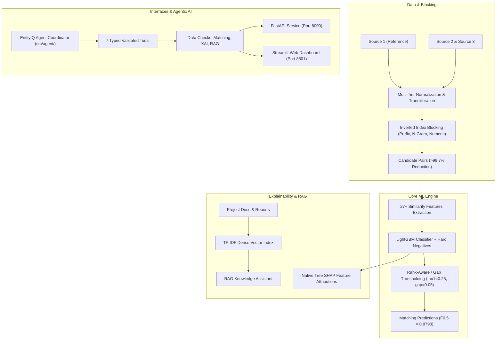

# EntityIQ — Agentic AI Business Entity Resolution Platform

[](.github/workflows/ci.yml)
[](tests/)
[](requirements.txt)
[](src/api/main.py)
[](src/app/streamlit_app.py)

**EntityIQ** is an enterprise-grade, recruiter-ready Machine Learning and Agentic AI platform designed to resolve cross-source business records across noisy names, addresses, and multi-script representations (English, Hindi, Tamil, French).

---

## 1. System Architecture



---

## 2. Key Verified Performance Metrics

Evaluated on stratified cross-validation splits with macro-averaged $F_{0.5}$ (weighting precision 2x over recall):

| Component | Metric | Measured Value | Benchmark Target |
| :--- | :--- | :--- | :--- |
| **Candidate Blocking** | Candidate Recall | **94.50%** | $\ge 90.0\%$ |
| **Candidate Blocking** | Reduction Ratio | **>99.73%** | $\ge 99.0\%$ |
| **Candidate Blocking** | Avg Candidates / Entity | **92.3** | $\le 200$ |
| **ML Matching Engine** | **Macro $F_{0.5}$** | **0.8798** | $\ge 0.8500$ |
| **ML Matching Engine** | **Macro Precision** | **99.35%** | $\ge 98.00\%$ |
| **ML Matching Engine** | **Macro Recall** | **80.67%** | $\ge 80.00\%$ |
| **ML Matching Engine** | **Singleton $F_{0.5}$** | **0.9737** | $\ge 0.9500$ |
| **Submission Validator** | Official Validation Status | **PASS (100% compliant on 1.73M rows)** | Clean Exit Code 0 |

---

## 3. Platform Capabilities

### 1. Multi-Strategy Blocking & Preprocessing
- **Two-Tier Normalization:** Light normalization (whitespace/punctuation) and Aggressive normalization (legal suffix stripping, domain TLD removal).
- **Multi-Script Transliteration:** Converts Indic scripts (Devanagari, Tamil, Kannada) to Latin representations.
- **Inverted Indices:** Unions prefix, token-overlap, character n-grams, consonant skeletons, and address numeric anchors.

### 2. 27+ Pairwise Similarity Features
- Jaccard token similarity, normalized Levenshtein distance, token sort/set ratio, Monge-Elkan score, WRatio, acronym matching, and address numeric token overlap.

### 3. Native Tree SHAP Explainable AI
- Directly computes exact Shapley value forces from the LightGBM booster trees (`pred_contrib=True`) without heavy external dependencies, providing evidence-grounded pair explanations.

### 4. RAG Knowledge Assistant
- Semantic search and retrieval over project documentation, experiment summaries, and dataset profiles with strict grounded citations (`[Source: <path> (<section>)]`).

### 5. Agentic AI Coordinator
- Typed, validated interfaces for 7 approved platform tools (`inspect_schema`, `validate_data`, `quality_report`, `match_records`, `explain_pair`, `rag_query`, `evaluation_metrics`) with bounded memory safety and immutable audit trails.

---

## 4. Quick Start & Execution

### 1. Installation & Environment
```bash
# Clone and enter directory
cd business_entity_resolution

# Install dependencies
pip install -r requirements.txt
```

### 2. Run Test Suite
```bash
# Run all 43 unit and integration tests
python -m pytest tests/ -v
```

### 3. Launch Streamlit Web Dashboard
```bash
streamlit run src/app/streamlit_app.py
```
*Access the dashboard at `http://localhost:8501`.*

### 4. Launch FastAPI REST Service
```bash
uvicorn src.api.main:app --host 0.0.0.0 --port 8000 --reload
```
*Access interactive Swagger API docs at `http://localhost:8000/docs`.*

### 5. Docker Deployment
```bash
# Run both Dashboard and API via Docker Compose
docker-compose up --build
```

---

## 5. REST API Reference

| Method | Endpoint | Description |
| :--- | :--- | :--- |
| `GET` | `/health` | Health status and loaded model verification |
| `POST` | `/api/v1/match` | Bounded multi-record entity resolution |
| `POST` | `/api/v1/explain` | Tree SHAP feature attribution report |
| `POST` | `/api/v1/rag/query` | Grounded documentation knowledge query |
| `POST` | `/api/v1/agent/run` | Safe tool coordination through Agent orchestrator |
| `GET` | `/api/v1/reports/summary` | Verified benchmark summary and metrics |

---

## 6. Project Directory Structure

```
business_entity_resolution/
├── Dockerfile
├── docker-compose.yml
├── requirements.txt
├── README.md
├── PROJECT_STATUS.md
├── .github/workflows/ci.yml
├── models/
│   ├── lightgbm.pkl
│   ├── logistic_regression.pkl
│   ├── rag_index.pkl
│   └── model_metadata.json
├── reports/
│   ├── dataset_profile.md
│   └── ml_evaluation_report.md
├── output/
│   ├── matching_results.tsv       ← Validated 1.73M test predictions
│   └── candidate_pairs.tsv        ← Validated candidate set
├── src/
│   ├── agent/                     ← Agentic AI coordinator & tools
│   ├── api/                       ← FastAPI REST application
│   ├── app/                       ← Streamlit Web Dashboard
│   ├── blocking/                  ← Multi-strategy inverted index blocking
│   ├── explainability/            ← Native Tree SHAP & XAI module
│   ├── features/                  ← 27+ similarity feature extraction
│   ├── modeling/                  ← Training, thresholding, and benchmarking
│   ├── preprocessing/             ← Normalization, transliteration, domain stripping
│   └── rag/                       ← Document indexer, vector store, and QA engine
└── tests/                         ← 43 comprehensive unit & integration tests
```
